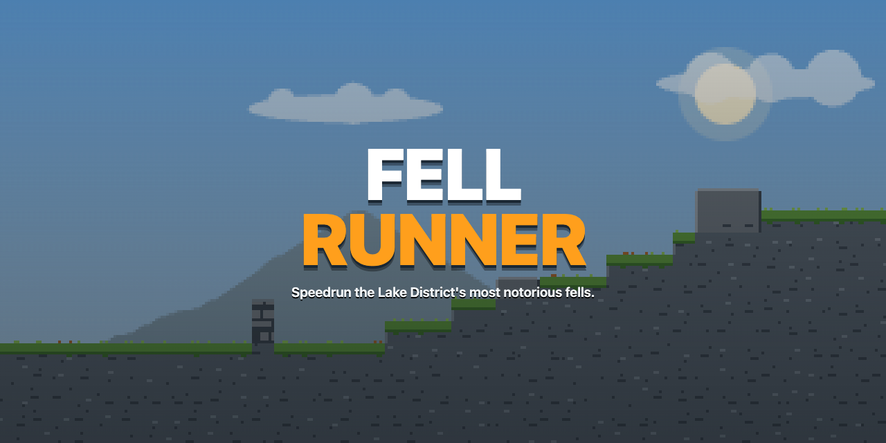
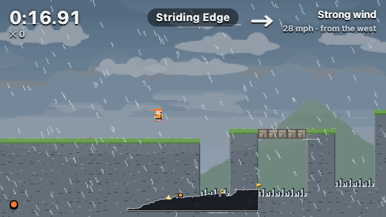
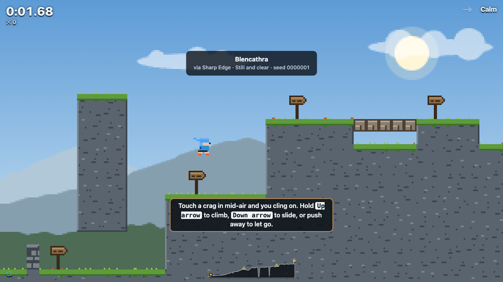
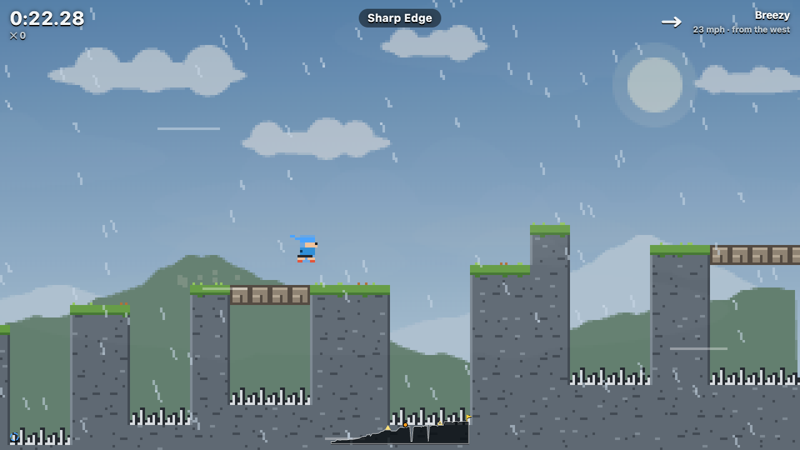
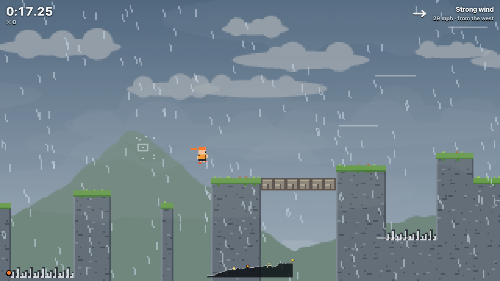
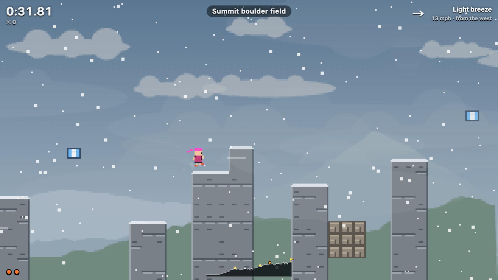
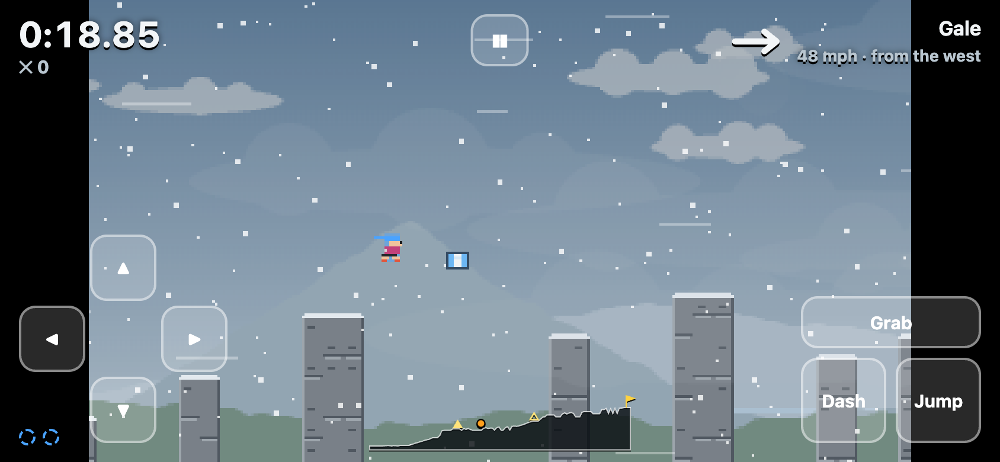
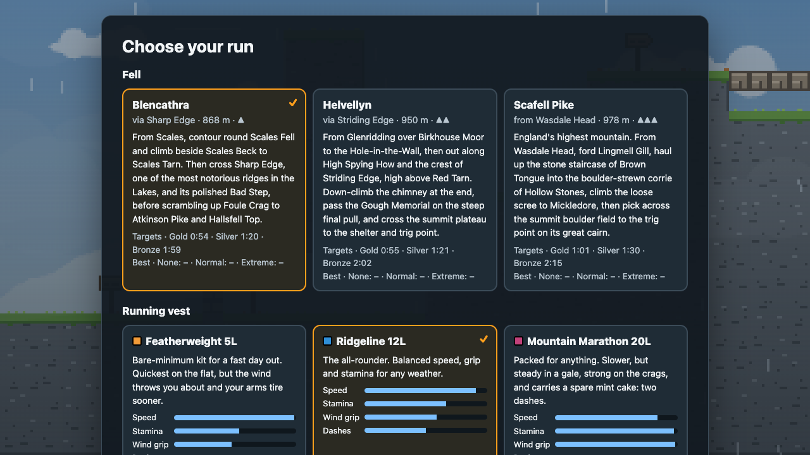
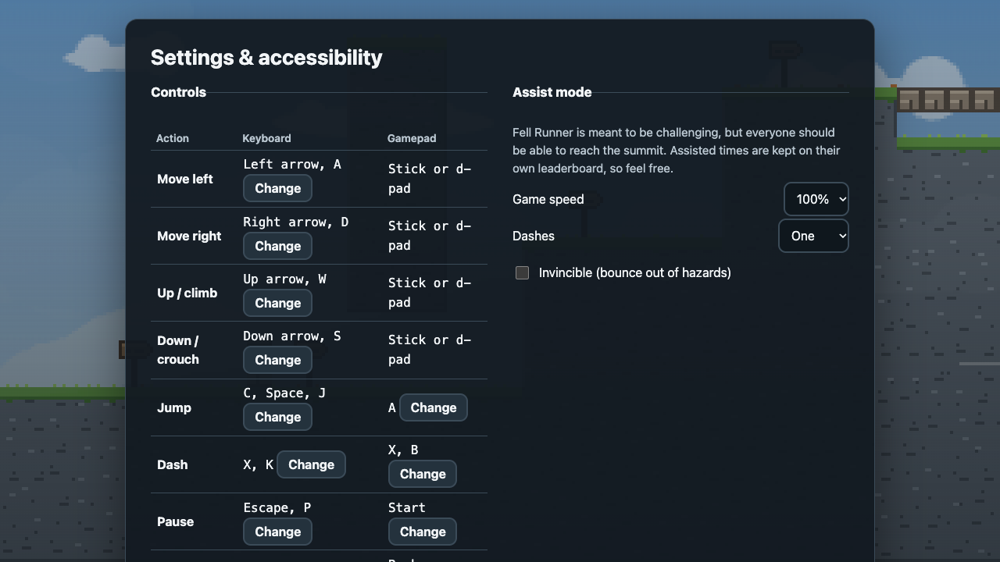

<div align="center">



**A Celeste-style speedrunning platformer over three notorious Lake District fells,<br>where the weather is seeded, the wind is physics, and the mountain rescue team is real.**

[](https://github.com/rmcrkd/fell-runner/actions/workflows/ci.yml)


[](LICENSE)
[](https://penrithmrt.org.uk/donate)

### [▶ Play in your browser](https://rmcrkd.github.io/fell-runner/)



</div>

## The game

Race from the valley floor to the summit. A good run takes about a minute; your first attempt, in a gale, will take rather longer.

- **A gentle start.** Blencathra opens with a hazard-free stretch through Scales, where wooden fingerposts teach each move (jump, wall kick, climb, loose rock, dash and wind shelter) and name your own keys, buttons or touch controls.
- **Tight, Celeste-style movement.** Coyote time, jump buffering, variable jump height, wall jumps, stamina-limited climbing, eight-way dashes and corner correction. Super jumps, hypers and wall bounces are there for players who go looking.
- **Real routes.** Each fell follows its real path, and the places along it (Scales Tarn, the Hole-in-the-Wall, Mickledore and the rest) come up on screen as you reach them.
- **Seeded weather.** Wind, gusts, rain, sleet, snow and hill fog all come from a seed you can see, type, randomise or share. The same seed brings the same gust at the same moment, so races are fair.
- **Wind is physics.** It shoves you in the air and less so on the ground. It's gentler in the valley and full force on the tops, and a crag or wall on the windward side gives you shelter. You get about a second's warning of every gust.
- **Loose rock.** Greasy slabs of slate and scree crack as you land, hold you for a moment, then give way. Keep moving.
- **Three vests** trade speed against stamina, wind resistance and dashes.
- **Target times.** Gold, silver and bronze for each fell, set from a solver-timed reference route, so you know what a good run looks like.
- **Ghosts, splits, replays and personal bests** for every fell and weather setting, plus a route map showing you and your ghost.
- **Challenge links** load the exact same fell, vest and storm for a friend.
- **No build step and no runtime dependencies.** It's plain JavaScript modules and a canvas.



## The fells

| | Fell | Route | Height |
|---|---|---|---|
| ▲ | **Blencathra** via Sharp Edge | The hamlet of Scales, round Scales Fell and up Scales Beck to Scales Tarn, across the teeth of **Sharp Edge** and its polished Bad Step, up Foule Crag to Atkinson Pike and the survey ring on Hallsfell Top | 868 m |
| ▲▲ | **Helvellyn** via Striding Edge | Glenridding, over Birkhouse Moor to the Hole-in-the-Wall, High Spying How and the crest of **Striding Edge** above Red Tarn, down the chimney, past the Gough Memorial, then the summit shelter and trig point | 950 m |
| ▲▲▲ | **Scafell Pike** from Wasdale Head | Ford Lingmell Gill, climb the stone staircase of Brown Tongue, cross the boulders of Hollow Stones, scramble the loose scree to **Mickledore**, then the summit boulder field to the trig point on its great cairn | 978 m |

<table>
  <tr>
    <td></td>
    <td></td>
  </tr>
  <tr>
    <td></td>
    <td></td>
  </tr>
</table>

Cairns are checkpoints and splits. Kendal mint cake refills your dash and stamina in mid-air, and on Scafell Pike some gaps can only be crossed by dashing to a mint cake and dashing again. Sharp rocks, tarns and big drops send you back to the last cairn.

## Vests

| Vest | Speed | Stamina | In the wind | Dashes |
|---|---|---|---|---|
| **Featherweight 5L** | 108% | 80% | Blown about more | 1 |
| **Ridgeline 12L** | 100% | 100% | Normal | 1 |
| **Mountain Marathon 20L** | 92% | 145% | Much steadier | 2 |

## Weather

| Difficulty | What to expect |
|---|---|
| **None** | Still and clear: pure movement. |
| **Normal** | A typical Lakeland day: breezy, gusty on the tops, passing showers and patchy clag. |
| **Extreme** | Named-storm weather: gales, driving rain or snow, and thick hill fog. |

The forecast for a seed is shown before you start. **Daily seed** gives everyone the same weather for the day.



## Controls

| Action | Keyboard | Gamepad | Touch |
|---|---|---|---|
| Move | Arrows / WASD | Stick / d-pad | On-screen pad |
| Jump | C / Space / J | A | Jump |
| Dash | X / K | X or B | Dash |
| Grab and climb | Z / L / Left Shift | Bumpers or triggers | Grab |
| Restart | R | Back | |
| Pause | Esc / P | Start | ❚❚ |
| Read out status | I | Y | |

Every key and gamepad button can be remapped, and grab can be set to hold or toggle.

## Accessibility

Fell Runner should be hard, but everyone should be able to reach the summit.



- **Assist mode**, inspired by Celeste's: game speed from 50% to 100%, infinite stamina, two or infinite dashes, and invincibility. Assisted times go on their own board beside the others, so they never displace unassisted ones and are never hidden.
- **Remappable keys and gamepad buttons.** Grab can be hold or toggle. Keyboard, gamepad and touch all work, and the touch controls fit a 320 px screen.
- **Menus and the HUD are real HTML.** That makes them screen-reader friendly, keyboard and gamepad navigable, and zoomable. Screen readers hear place names, signpost tips, cairns, splits, target times and results, and a **read out status** key speaks your time, position, the wind, gusts, dashes and stamina on demand.
- **Signpost tips** are HTML too, scale with the HUD, and name the controls you're actually using. Experienced runners can turn them off.
- **High-contrast mode, with nothing told by colour alone.** Spent dashes switch to dashed outlines, splits carry ▲/▼, reached cairns gain a flag, crumbling rock shows widening cracks and leaves a dotted outline when it falls, and the route map marks you, your ghost, cairns and the summit with different shapes.
- **Reduce motion** removes parallax, bobbing, dash trails, shaking rock and screen shake. It's on by default if your system asks for reduced motion, and high contrast likewise follows your system setting.
- **No flashing effects.** A tired climber shows a sweat drop instead of a flashing sprite.
- **Weather visibility controls.** Rain and snow can be turned down or off, and you can set a maximum fog thickness.
- **Wind you can see and hear.** A gauge shows direction, speed and shelter, there are wind streaks, a gust warning with a countdown, and stereo-panned wind audio. Optional sound captions cover the rest, including the crack of loose rock about to go.
- **Adjustable HUD size**, up to 200%.
- **Automatic pause** when the window loses focus.

Every screen (menus, play, pause, results, replay and touch controls) passes an automated [axe-core](https://github.com/dequelabs/axe-core) audit for WCAG 2.2 AA plus best practice, at desktop, phone and 320 px widths, in both the normal and high-contrast themes. A scripted keyboard-only walkthrough checks that every screen and action can be reached, with focus always visible.

## Speedrunning

- The clock starts on your first move and stops at the summit. Time is counted in fixed 60 Hz physics steps, so it doesn't depend on your frame rate (or on the brief freeze when you dash).
- **Target times** are the same in every weather, so a storm makes them harder:

  | Fell | Gold | Silver | Bronze |
  |---|---|---|---|
  | Blencathra | 0:54 | 1:20 | 1:59 |
  | Helvellyn | 0:55 | 1:21 | 2:02 |
  | Scafell Pike | 1:01 | 1:30 | 2:15 |

- Your best run on each fell and weather setting saves a **ghost** to race and **splits** for every cairn.
- **Watch best run** replays your ghost in the weather it ran in, and **Watch this run** replays any run from the results screen.
- **Ghost's weather** loads the seed your best ghost ran in, for a true like-for-like attempt.
- After a run, **Copy challenge link** shares the fell, vest and seed, for example `?fell=scafell&weather=extreme&seed=0K3P9QX&vest=mountain`.
- Tech: **super jump** (jump during a sideways ground dash), **hyper** (down-diagonal dash into the ground, then jump), **wall bounce** (up-dash beside a crag, then jump).

Times and ghosts are stored only in your browser.

## Play locally

```sh
git clone https://github.com/rmcrkd/fell-runner.git
cd fell-runner
npm start            # serves the game at http://localhost:8080
npm test             # everything, including proof that every fell can be finished (about 2 minutes)
npm run test:quick   # unit tests only (under a second)
npm run par          # reference times and cairn spacing for each fell
npm run links        # check the donation, forecast and credit links still work
```

You only need Node 22 or later, and only for the dev server and tests. The game itself is static files.

The browser tools in [`tools/browser`](tools/browser) (an accessibility audit, a keyboard-only walkthrough, and the script that captured this README's images) have their own dev dependencies. They never ship with the game:

```sh
cd tools/browser && npm install
npm run audit       # axe-core on every screen, sizes and themes
npm run keyboard    # keyboard-only walkthrough
npm run capture     # regenerate docs/ images and GIF from real gameplay
```

## How it's built

```
index.html, styles.css   menus, HUD and settings: accessible HTML over the canvas
src/
  player.js     Celeste-style controller (integer positions, sub-pixel remainders)
  run.js        one attempt: clock, cairns, splits, mint cakes, respawns, ghost recording
  weather.js    seeded wind, gusts, rain/sleet/snow, fog and grip
  level.js      tiles, collision, hazards, loose rock, and wind exposure and shelter
  levels/       each fell is a list of named sections of plain text, one character per tile
  clock.js      turns real time into fixed 60 Hz steps
  targets.js    gold, silver and bronze times from each fell's reference route
  render.js     procedural pixel art at 320×180: parallax fells, weather, the runner, sheep
  routemap.js   the HUD's elevation profile
  ghost.js      compact ghost recordings (5 bytes per physics step)
  replay.js     watch a ghost back in its own weather
  input.js      keyboard, gamepad and touch, remappable
  audio.js      synthesised effects and wind, no audio files
tools/
  solver.js     finds routes to the summit using the real physics
  par.js        reference times for each fell
  browser/      dev-only accessibility audit, keyboard walkthrough and captures
```

**Every fell is proven finishable.** The test suite runs `tools/solver.js`, which drives the real `Player` physics through scripted runs, jumps, wall kicks, chimneys, climbs, waits and dashes from every spot it can reach. It checks every fell with every vest:

- in calm weather (without dashing, on the two fells that don't need it),
- in the worst steady Extreme gale, both head-on and from behind, on the greasiest rock,
- in the two worst seeded Extreme storms out of 500, gusts and all.

A solved storm route is then replayed frame by frame through a real `Run`, cairn by cairn, to the summit.

**Every fell is about a minute long.** `npm run par` finds a near-optimal route with an A* search over the same physics. The reference routes take 40 s (Blencathra), 40 s (Helvellyn) and 45 s (Scafell Pike), which puts a skilled player at roughly 55 to 60 seconds: the gold target is 1.35 times the reference, silver twice it and bronze three times. Cairns fall every 13 to 17 seconds of reference route.

## Privacy and security

Fell Runner has no accounts, server, analytics, cookies or third-party scripts. Your settings, times and ghosts stay in your own browser. A strict Content-Security-Policy lets the page run only its own files, the workflows pin every action to an exact commit, and a monthly check makes sure the donation and forecast links still work. To report a security problem privately, see [SECURITY.md](SECURITY.md).

## Contributing

New fells, routes and fixes are welcome. Levels are just text, and [CONTRIBUTING.md](CONTRIBUTING.md) explains the tile key, how sections fit together, and how to check that your level is fair and finishable.

## The real fells

Sharp Edge, Striding Edge and the Scafell massif are real places, and people are hurt on them every year, often in exactly the weather this game throws at you. On the real fells there are no respawns. Check a mountain forecast such as the [Lake District Weatherline](https://www.lakedistrictweatherline.co.uk/) or [MWIS](https://www.mwis.org.uk/), and carry the kit and skills to navigate.

> **In an emergency in the UK mountains, dial 999, ask for the Police, then Mountain Rescue.**

Lakeland's mountain rescue teams are unpaid volunteers, on call around the clock and funded mostly by donations. Fell Runner is free. If you enjoy it, please **[donate to Penrith Mountain Rescue Team](https://penrithmrt.org.uk/donate)**. The game offers the same link on its title screen, after every summit, and on its mountain-safety page.

<sub>Fell Runner is an unofficial fan project. It is not affiliated with or endorsed by Penrith Mountain Rescue Team, or by the makers of Celeste.</sub>

## Credits

- **Created by** Ryan McCrickerd, with AI assistance from Claude by Anthropic, through [Claude Code](https://claude.com/claude-code).
- **Movement** is modelled on [Celeste](https://www.celestegame.com/) by Maddy Thorson and Noel Berry. Its constants and techniques (coyote time, buffering, wall jumps, climbing stamina, dashes, supers and hypers) follow the [player controller they published](https://github.com/NoelFB/Celeste), and the assist mode and crumbling loose rock follow Celeste's lead too.
- **Inspiration and real-world heroism:** [Penrith Mountain Rescue Team](https://penrithmrt.org.uk/) and every Lakeland mountain rescue team.
- **Forecast services** recommended in-game: the Lake District National Park's [Weatherline](https://www.lakedistrictweatherline.co.uk/) and [MWIS](https://www.mwis.org.uk/).
- **Algorithms:** Mulberry32 random numbers by Tommy Ettinger; FNV-1a hashing by Glenn Fowler, Landon Curt Noll and Kiem-Phong Vo; and A* search by Peter Hart, Nils Nilsson and Bertram Raphael, which times the reference routes.
- **Development tools:** accessibility audited with [axe-core](https://github.com/dequelabs/axe-core) by Deque, screenshots captured with [Puppeteer](https://pptr.dev/), images decoded with [pngjs](https://github.com/pngjs/pngjs), and the GIF encoded with [gifenc](https://github.com/mattdesl/gifenc) by Matt DesLauriers. None of these ship with the game.

## Citing

If you refer to Fell Runner in a talk, paper or article, GitHub's **Cite this repository** button (from [CITATION.cff](CITATION.cff)) gives a ready-made citation.

## Licence

[MIT](LICENSE) © Ryan McCrickerd
